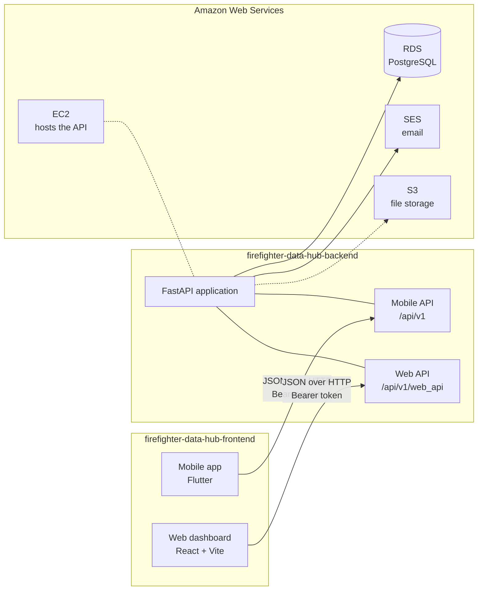
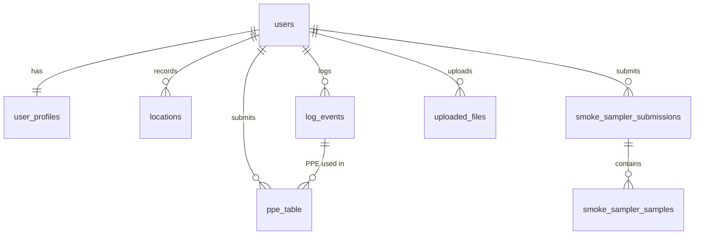

# System Architecture

This document describes how the Firefighter Safety Data Hub is put together. The system is split across two repositories:

| Repository | Contents |
|---|---|
| `firefighter-data-hub-backend` | REST API (FastAPI), database models and migrations, email integration |
| `firefighter-data-hub-frontend` | Mobile app for firefighters (Flutter) and web dashboard for researchers (React) |

---

## 1. Purpose

The Firefighter Safety Data Hub is a proof-of-concept platform for firefighter exposure research.

- **Firefighters** use the mobile app to record fire events, the personal protective equipment (PPE) they wore, smoke sampler results and their location.
- **Researchers** use the web dashboard to view summary statistics, browse the collected data and export it to CSV.

---

## 2. Components

| Component | Technology | Responsibility |
|---|---|---|
| Mobile app | Flutter 3 / Dart 3.11 | Account management, consent, GPS tracking, event / PPE / smoke sampler forms |
| Web dashboard | React 19, TypeScript, Vite, Tailwind CSS | Researcher login, dashboard, data tables, CSV export |
| API | Python 3.11, FastAPI, SQLAlchemy 2, Alembic | Authentication, validation, persistence, email |
| Database | PostgreSQL (Amazon RDS) | All application data |
| Email | Amazon SES | Verification, login notification, password reset, account deletion emails |
| File storage | Amazon S3 | Optional file uploads (`/files` endpoints) |
| Hosting | Amazon EC2 (Ubuntu, systemd, uvicorn) | Runs the API |

The two client applications never communicate with each other or with the database directly. All data flows through the API.

---

## 3. Data flow

### 3.1 Firefighter submits data (mobile → API → database)

1. The firefighter registers in the mobile app. The API creates a `users` row and a `user_profiles` row, then emails a verification token through SES.
2. The firefighter pastes the token into the app. The API marks the account as verified.
3. The firefighter logs in and receives a JWT access token, which the app stores in secure storage and sends as `Authorization: Bearer <token>` on every request.
4. The app records GPS positions in the background, buffers them in a local SQLite database and uploads them in batches to `POST /api/v1/locationEntries/`.
5. Event, PPE and smoke sampler forms are submitted to their endpoints and stored in their tables.

### 3.2 Researcher reads data (web → API → database)

1. The researcher logs in on the web dashboard through `POST /api/v1/web_api/auth/login` (researcher accounts are stored separately, in `users_researcher`).
2. The dashboard requests the summary, GPS table and event table endpoints, which read from the tables populated by the mobile app.
3. CSV export endpoints stream the same data as downloadable files.

---

## 4. API surface

The API exposes two route groups from the same FastAPI application. The complete endpoint list is in the backend repository (`docs/API.md`), and live documentation is served at `/docs` on any running instance.

| Route group | Prefix | Client | Main features |
|---|---|---|---|
| Mobile API | `/api/v1` | Mobile app | Auth, email verification, password reset, account deletion, location, PPE, event log, smoke sampler, files, health |
| Web API | `/api/v1/web_api` | Web dashboard | Researcher auth and profile, dashboard summary, GPS table, event table, CSV exports |

---

## 5. Data model

| Table | Description |
|---|---|
| `users` | Firefighter accounts: email, password hash, role, refresh token, email verification status |
| `user_profiles` | Demographic and service profile: station, firefighter type, experience, height, weight, etc. |
| `users_researcher` | Researcher accounts for the web dashboard |
| `locations` | GPS points uploaded by the mobile app |
| `log_events` | Fire events: date, address, whether the usual PPE was worn |
| `ppe_table` | PPE item IDs (helmet, hood, face mask, SCBA, gloves, boots, coat, pants), optionally linked to an event |
| `smoke_sampler_submissions`, `smoke_sampler_samples` | Smoke sampler submissions and the chemicals/percentages in each |
| `uploaded_files` | Metadata for files stored in S3 |
| `location_entries` | Legacy location table, no longer written to |

Deleting an account (`DELETE /api/v1/auth/delete-account`) removes the user's profile, locations, events, PPE, smoke sampler records and file metadata.

---

## 6. Authentication

- Passwords are hashed with bcrypt (`passlib`).
- The API issues HS256 JWTs containing the user ID (`sub`) and role. The lifetime is set by `ACCESS_TOKEN_EXPIRE_MINUTES` (default seven days).
- The most recently issued token is stored on the user record and checked on each request. Logging in again, refreshing or changing the password replaces it, which invalidates older tokens.
- Login is refused until the account's email address has been verified.
- Email verification and password reset tokens are signed separately with `EMAIL_TOKEN_SECRET`.

---

## 7. Configuration overview

| Where | How it is configured |
|---|---|
| API | Environment variables in `.env` (see `.env.example` in the backend repository) |
| Web dashboard | `VITE_*` environment variables in `web/.env`, baked in at build time |
| Mobile app | Constants in `mobile/lib/config/app_config.dart` |

Secrets (database credentials, JWT and email token secrets, AWS keys, Android signing keys) are never committed. Each repository's `.gitignore` excludes them.

---

## 8. Current deployment

| Item | Value |
|---|---|
| API host | Single Ubuntu EC2 instance |
| Process | `uvicorn` on port 8000, managed by the systemd service `firefighter` |
| Database | Amazon RDS for PostgreSQL |
| Email | Amazon SES, region `us-east-1` |
| Protocol | HTTP (HTTPS through Nginx and a domain is planned) |
| Web dashboard | Built with `npm run build`; static hosting to be decided |
| Mobile app | Android package `com.sloumua.firefighterguard`, version 1.0.1+4 |

Deployment steps are documented in the backend repository (`docs/DEPLOYMENT.md`).
